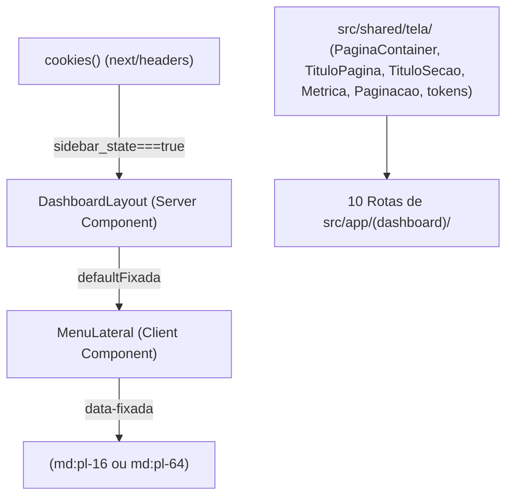

# Revisão Geral de Design — Design (`design-geral`)

**Spec**: `.specs/features/design-geral/spec.md`
**Status**: Approved (Party Mode)

---

## Architecture Overview

A revisão de design atua exclusivamente na camada de apresentação de `src/app/(dashboard)/` e nos primitivos compartilhados de `src/shared/tela/` e `src/shared/filters/`, sem alterar Server Actions, queries do Supabase ou regras de domínio.

---

## 1. Sidebar Recolhível sem Flash de Hidratação (T46)

### 1.1 Leitura Server-Side no Next.js 16 (`src/app/(dashboard)/layout.tsx`)
Conforme `node_modules/next/dist/docs/01-app/03-api-reference/04-functions/cookies.md`, `cookies()` é assíncrono no Next.js 16:
- `const cookieStore = await cookies();`
- `const fixadaInicial = cookieStore.get("sidebar_state")?.value === "true";`
- Quando o cookie não existe (1º acesso), `fixadaInicial` é `false` (**recolhida por padrão**).
- `DashboardLayout` envolve `<MenuLateral>` e `<main>` em um container com atributo ou classe reativa ao estado `fixada`, ou passa `defaultFixada={fixadaInicial}` para `<MenuLateral>` (que sincroniza `data-sidebar-pinned` / classe no wrapper ou controla o espaçamento de `<main>`).
- Para que o `<main>` acompanhe o pino imediatamente no SSR e quando o usuário clicar no pino no cliente sem re-renderizar o Server Component:
  - Usamos uma variável CSS / atributo no container pai ou um `
`, ou renderizamos o `sidebar-gap` irmão do `<aside>` (exatamente como o `Sidebar` do shadcn faz: um `
` dentro de um layout `md:flex`).
  - **Por que o `sidebar-gap` irmão (ou padding controlado) é superior:** quando `fixada = false`, o gap no fluxo tem `w-16` (`4rem` = `64px`). Quando o usuário apenas passa o mouse (`pairando = true`, `fixada = false`), o `<aside className="fixed inset-y-0 left-0 z-30 ...">` expande de `w-16` para `w-64` (`16rem`) com `shadow-2xl` **por cima** do conteúdo, sem alterar a largura do `sidebar-gap` e portanto **sem empurrar nem refluir as tabelas e cartões da tela**. Quando o usuário clica no botão **Fixar**, `fixada` vira `true` e a largura reservada passa para `w-64`.

### 1.2 Comportamento de Hover, Teclado e Pino (`src/app/(dashboard)/menu-lateral.tsx`)
- **Breakpoints (`md:` = `768px`):**
  - `< 768px` (`md:hidden`): barra fixa no topo (`h-16`) com `Marca` e botão `"Abrir menu"` (`size-11`, `44x44px`), abrindo gaveta modal (`role="dialog"`, `aria-modal="true"`, `aria-label="Menu"`) que fecha no backdrop, no botão `"Fechar menu"` (`size-11`), ao clicar num link ou ao teclar `Escape`.
  - `>= 768px` (`hidden md:flex`): sidebar lateral fixa à esquerda (`bg-slate-950 text-white`).
- **Estados da Sidebar Desktop (`>= 768px`):**
  - `fixada`: boolean iniciado com `defaultFixada` (default `false`) e persistido em `document.cookie = "sidebar_state=" + fixada + "; path=/; max-age=31536000"`.
  - `pairando`: boolean controlado por `onPointerEnter` / `onPointerLeave` **apenas quando `e.pointerType === "mouse"`**, com `setTimeout` de `120ms` para abrir e `220ms` para fechar (igual ao `App.tsx` da Gabi Modas, evitando pulos ao esbarrar na borda e evitando sticky-hover em telas touch).
  - `focoTeclado`: `onFocusCapture` na `<aside>` expande imediatamente sem delay quando o foco entra via teclado (`:focus-visible`), e `onBlurCapture` recolhe quando o foco sai totalmente da `<aside>` (`!e.currentTarget.contains(e.relatedTarget)`).
  - `expandida = fixada || pairando || focoTeclado`: define `data-state={expandida ? "expanded" : "collapsed"}` e `data-collapsible={expandida ? "" : "icon"}`.
- **Botão de Pino ("Fixar aberta"):**
  - Posicionado no cabeçalho da sidebar (`md:flex`), com tamanho mínimo de `44x44px` (`size-11` quando recolhida ou `size-10`/`size-11` com área de toque `min-h-11 min-w-11`), `aria-pressed={fixada}`, `aria-label={fixada ? "Soltar a barra lateral (abre só com o mouse)" : "Fixar a barra lateral aberta"}`, `title={fixada ? "Soltar a barra" : "Fixar aberta"}`, e anel de foco visível `focus-visible:ring-2 focus-visible:ring-orange-300`.
  - Quando a sidebar está recolhida (`!expandida`), o cabeçalho mostra o ícone da marca/pino centralizado; quando expandida, mostra a `Marca` à esquerda e o botão de pino à direita.
- **Links de Navegação e Conta no Modo Ícone:**
  - Cada `<Link>` tem `aria-label={label}` e `title={!expandida ? label : undefined}` e altura mínima de `44px` (`min-h-11`).
  - Quando `!expandida`, o rótulo textual fica oculto visualmente (`sr-only`) e o ícone (`size-5 shrink-0`) fica centralizado; quando `expandida`, o rótulo aparece ao lado do ícone. Usar `sr-only` em vez de `hidden` garante que `getByRole("link", { name: "Painel" })` e `links[0].textContent` continuem funcionando em 100% dos testes unitários e E2E tanto aberta quanto fechada!

---

## 2. Escala Única de Tipografia e `tabular-nums` (T47)

Centralizada em `src/shared/tela/titulo-pagina.tsx` (e reexportada para todas as páginas):

| Primitivo / Token | Classe Tailwind | Uso |
| :--- | :--- | :--- |
| `TituloPagina` (eyebrow) | `text-xs font-bold uppercase tracking-[0.14em] text-orange-700` | Contexto acima do `h1` (máx. 1 por tela) |
| `TituloPagina` (`h1`) | `mt-1 text-2xl font-bold tracking-tight text-stone-950 sm:text-[1.75rem]` | Título principal da tela |
| `TituloSecao` / `tituloSecao` (`h2`) | `text-base font-bold tracking-tight text-stone-950` | Título de cartão/seção interna (substitui `text-lg font-black`) |
| `Metrica` (rótulo) | `text-xs font-semibold text-slate-600 sm:text-sm` | Rótulo superior do KPI |
| `Metrica` (valor) | `mt-1 text-2xl font-bold tracking-tight text-stone-950 tabular-nums` | Número principal do KPI com dígitos tabulares |
| `textoPrimario` | `text-sm font-semibold text-stone-950` | Nome principal em linhas de lista (pet, tutor, produto, serviço) |
| `textoMeta` | `text-xs font-medium text-slate-600 sm:text-sm` | Subtítulo/detalhe secundário da linha |
| `valorTabela` | `text-sm font-bold text-stone-950 tabular-nums` | Preços (`R$`), saldos (`un.`), horários (`09:00`) e datas |

---

## 3. Escala Única de Espaçamento (T48)

Centralizada em `src/shared/tela/titulo-pagina.tsx`:

| Primitivo / Token | Classe Tailwind | Uso |
| :--- | :--- | :--- |
| `PaginaContainer` | `mx-auto grid w-full max-w-6xl gap-6 p-4 sm:p-6 lg:p-8` | Moldura única das 10 rotas e de `loading.tsx` |
| `cartao` | `rounded-2xl border-2 border-slate-200 bg-white` | Superfície padrão de cartão (AD-011 / AD-012) |
| `cartaoForm` | `${cartao} p-4 sm:p-5` | Cartão com padding interno para formulários e blocos |
| `cabecalhoLista` | `flex flex-wrap items-center justify-between gap-2 border-b-2 border-slate-100 px-4 py-3.5 sm:px-5` | Cabeçalho de cartões de listagem |
| `itemLista` | `px-4 py-3.5 sm:px-5` | Padding vertical e horizontal uniforme nas linhas de `divide-y-2 divide-slate-100` |

---

## 4. Responsividade e Alvos de Toque >= 44px (T49)

- **Botões e Links de Ação (`min-h-11` / `h-11` = `44px`):**
  - `botaoPrimario`: `inline-flex min-h-11 items-center justify-center rounded-xl bg-orange-600 px-4 text-sm font-bold text-white transition-transform duration-150 ease-out hover:bg-orange-700 active:scale-[0.98] disabled:opacity-60`
  - `botaoSecundario` / `linkAtalho`: `inline-flex min-h-11 items-center justify-center rounded-xl border-2 border-slate-200 bg-white px-3.5 text-sm font-semibold text-slate-800 transition-colors hover:border-orange-500 active:scale-[0.98] disabled:opacity-60`
  - `campoInput`: `h-11 rounded-xl border-2 border-slate-200 bg-white px-3 text-sm font-medium text-stone-950 outline-none focus:border-orange-500`
- **Paginação (`src/shared/tela/paginacao.tsx`):**
  - Botões anterior/próxima passam de `p-2` (`36px`) para `inline-flex size-11 items-center justify-center rounded-xl border-2 border-slate-200 bg-white text-slate-800 hover:border-orange-500` (`44x44px`), e os contadores numéricos recebem `tabular-nums`.
- **Prevenção de Scroll Horizontal em `375px`:**
  - `AgendamentoAcoes`: botões `Editar`, `Cancelar`, `Concluir`, `Reabrir` com `min-h-11` distribuídos em `flex flex-wrap gap-2 w-full sm:w-auto`.
  - `RegistrarEntradaForm` (`/estoque`): input `h-11 w-24 tabular-nums` e botão `min-h-11` com `w-full sm:w-auto` na linha do produto para não estourar `375px`.
  - `HorarioDiaForm` (`/horario-funcionamento`): inputs `type="time"` com `h-11 tabular-nums` e layout responsivo em `375px`.
  - `RelatoriosPage`: barra de navegação entre meses com links `min-h-11` e título central sem quebrar ou gerar overflow em `375px`.
