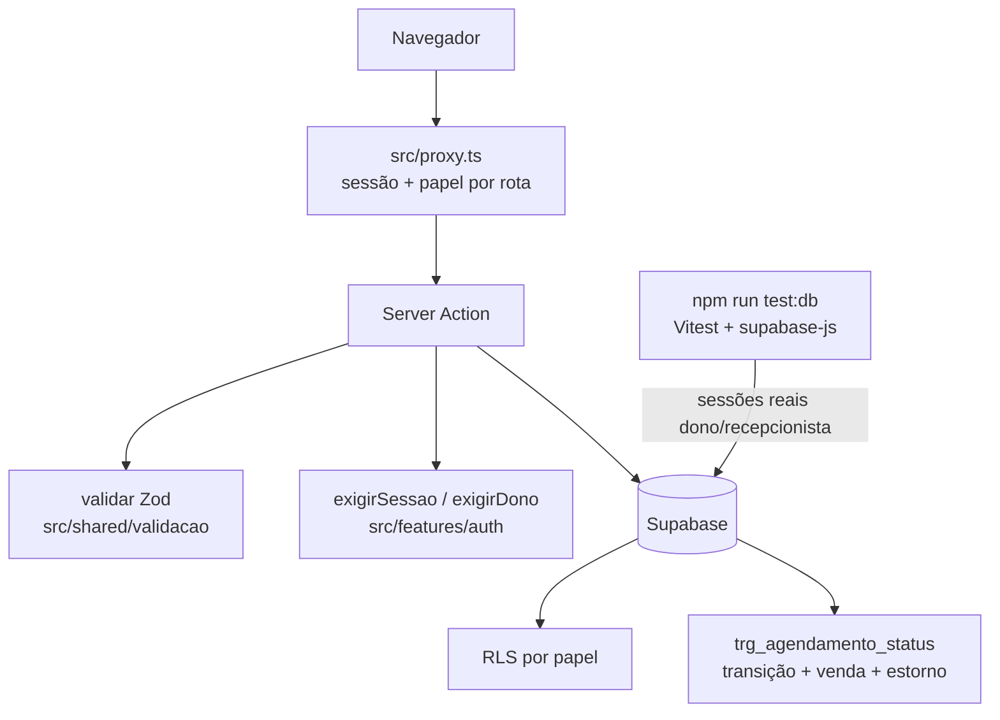

# Hardening Design

**Spec**: `.specs/features/hardening/spec.md`
**Status**: Approved (abordagens escolhidas pelo usuário em 2026-11-12: trigger de status + Vitest com supabase-js)

---

## Architecture Overview

Três camadas de defesa, de fora para dentro, e uma suíte que prova a camada de dentro contra um Postgres real.



**Regra de status no banco (trigger).** Todo `UPDATE` em `agendamentos` que muda `status` passa por `trg_agendamento_status` (BEFORE UPDATE, função `security definer`):

| De → Para | Efeito |
|---|---|
| `agendado → concluido` | insere 1 venda `servico` com `valor_total = sum(servicos.preco_interno)` |
| `concluido → agendado` | estorna a venda ativa (`estornada_em = now()`, `estornada_por = auth.uid()`) |
| `agendado → cancelado`, `cancelado → agendado` | só valida |
| `concluido → cancelado` | `raise 'Reabra o agendamento antes de cancelar'` (MAQ-02) |
| qualquer outra | `raise 'Transição de status inválida: <de> → <para>'` (MAQ-04) |

Update sem mudança de status (editar data/pet) não passa pela regra de transição.

As RPCs `concluir_agendamento` e `reabrir_agendamento_concluido` ficam, mas viram `security invoker` e só fazem: `select ... for update` → checa o status de origem (IDP-02/IDP-06, mensagens específicas) → `update status`. O trigger faz o resto. O `select for update` serializa chamadas concorrentes (IDP-03), e o índice único parcial é a segunda trava.

---

## Code Reuse Analysis

### Existing Components to Leverage

| Component | Location | How to Use |
|---|---|---|
| `createClient` (server) | `src/shared/supabase/server.ts` | Inalterado; as actions continuam criando o cliente depois da validação |
| `getCurrentUserRole` | `src/features/auth/queries.ts` | Base de `exigirSessao`/`exigirDono` |
| `getVendas` | `src/features/vendas/queries.ts` | Ganha o filtro `estornada_em is null`; relatório reaproveita (já chama `getVendas`) |
| Padrão `{ error?: string }` | todas as actions | Mantido; Zod e checagem de papel retornam no mesmo formato |
| Checagem de telefone com libphonenumber | `src/features/pets/actions.ts` | Vira `.refine` no schema do tutor |
| Matcher de rotas de dono | `src/middleware.ts` | Lógica movida para `src/proxy.ts` |
| Vitest | `vitest.config.ts` | Segunda config `vitest.db.config.ts` (env `node`, só `*.db.test.ts`) |

### Integration Points

| System | Integration Method |
|---|---|
| Supabase local | `npx supabase start` (Docker); chaves lidas de `npx supabase status -o json` no globalSetup |
| Migrations | Novas `0009`, `0010`, `0011` em `supabase/migrations/`, aplicadas por `supabase db reset` no `test:db` |
| Relatório mensal | Sem mudança de código: herda o filtro de `getVendas` |

---

## Components

### Harness de testes de banco
- **Purpose**: subir o banco limpo, criar dono/recepcionista no Auth local e dar um cliente autenticado por papel.
- **Location**: `vitest.db.config.ts`, `src/shared/supabase/__tests__/db-setup.ts` (globalSetup), `src/shared/supabase/__tests__/db-sessao.ts`
- **Interfaces**:
  - `setup(): Promise<void>`: checa `http://127.0.0.1:54321/auth/v1/health`; se falhar, lança `Supabase local não está rodando: rode "npx supabase start"`; senão roda `npx supabase db reset` e cria os dois usuários via admin API e o `profiles.role`.
  - `clienteComo(papel: "dono" | "recepcionista"): Promise<SupabaseClient>`: login real com e-mail/senha de teste.
  - `clienteAdmin(): SupabaseClient`: service role, só para montar cenário.
- **Dependencies**: Docker, devDependency `supabase` (CLI).
- **Reuses**: `@supabase/supabase-js` já instalado.

### Migrations
- `0009_vendas_estorno.sql`: `estornada_em timestamptz`, `estornada_por uuid references profiles`; troca `vendas_agendamento_unique` por `create unique index vendas_servico_ativa_unique on vendas (agendamento_id) where tipo = 'servico' and estornada_em is null`.
- `0010_agendamento_status_trigger.sql`: função `public.agendamento_status_guard()` (`security definer`, `set search_path`, `revoke ... from anon, public`) + `trg_agendamento_status`.
- `0011_rpcs_agendamento_invoker.sql`: `create or replace` das duas RPCs como `security invoker` com guarda de status de origem. Nenhum `delete from vendas` sobra.

### `validar`
- **Purpose**: aplicar um schema Zod e devolver o formato de erro do projeto.
- **Location**: `src/shared/validacao/validar.ts`
- **Interfaces**: `validar<T>(schema: z.ZodType<T>, input: unknown): { data: T } | { error: string }` → erro = `Dados inválidos. <mensagem do 1º issue>`.
- **Reuses**: nada; é o único ponto novo compartilhado.

### `exigirSessao` / `exigirDono`
- **Purpose**: checar sessão e papel no servidor antes da escrita (SEG-01/02).
- **Location**: `src/features/auth/queries.ts`
- **Interfaces**: `exigirSessao(): Promise<{ error?: string; role?: UserRole }>`, `exigirDono(): Promise<{ error?: string }>`.
- **Reuses**: `getCurrentUserRole`.

### Schemas Zod por action
- **Location**: dentro de cada `src/features/<dominio>/actions.ts`, como `const` não exportada (arquivo `"use server"` só exporta funções async; AD-002 mantém a pasta por domínio).

### `src/proxy.ts`
- **Purpose**: redirecionar sem sessão → `/login` em todas as rotas, menos `/login` e os assets; manter `/estoque` e `/relatorios` só para dono.
- **Reuses**: corpo atual de `src/middleware.ts` (que é apagado). Antes de escrever, ler o guia de proxy em `node_modules/next/dist/docs/` (AGENTS.md).

### Headers
- **Location**: `next.config.ts` → `headers()` com os três headers de SEG-03 em `source: "/:path*"`.

---

## Data Models

```sql
-- vendas (delta)
estornada_em  timestamptz null,
estornada_por uuid null references public.profiles (id)
-- invariante: no máximo 1 venda servico com estornada_em is null por agendamento
```

```typescript
// src/features/vendas/types (delta)
interface Venda { /* ... */ estornada_em: string | null }
```

---

## Error Handling Strategy

| Error Scenario | Handling | User Impact |
|---|---|---|
| Entrada fora do schema | `validar` retorna antes do Supabase | `Dados inválidos. <campo>` |
| Sem sessão | `exigirSessao` | `Sessão expirada. Entre novamente.` |
| Recepcionista em ação de dono | `exigirDono` | `Ação permitida só ao dono.` |
| Concluir fora de `agendado` | RPC `raise` → action mapeia pela mensagem | `Este agendamento já foi concluído.` / mensagem do spec |
| Cancelar concluído | trigger `raise` → action mapeia | `Reabra o agendamento antes de cancelar` |
| Editar fora de `agendado` | action checa status antes do update | `Só é possível editar agendamentos agendados` |
| Erro de banco não previsto | mensagem genérica atual (sem vazar `error.message`) | inalterado |

---

## Risks & Concerns

| Concern | Location (file:line) | Impact | Mitigation |
|---|---|---|---|
| Testes unitários mockam o Supabase; regra de banco nunca foi exercida | `src/features/agenda/__tests__/concluir.test.ts` | Furo de RLS/RPC passa verde | Fase 1 (`test:db`) antes de qualquer migration |
| `reabrir` apaga venda e é `security definer` sem checar status | `supabase/migrations/0007_reabrir_agendamento_concluido.sql:29` | Faturamento some sem rastro | 0009 + 0011 (estorno + invoker + guarda) |
| `concluir` lê o status e ignora | `supabase/migrations/0006_concluir_agendamento.sql:39` | Hoje só a unique salva; a unique vai virar parcial | Guarda de origem na RPC (0011) |
| Cancelar/editar sem guarda de status | `src/features/agenda/actions.ts:133`, `:89` | Agendamento cancelado com venda ativa | Trigger (0010) + checagem na action |
| `gerarRelatorioPdf` sem checagem de papel lê `vendas` (select liberado) | `src/features/relatorios/actions.ts:22` | Recepcionista baixa PDF de faturamento | `exigirDono` (T17) |
| Cadastro público do Supabase cloud não é controlável por código | painel Supabase | Qualquer pessoa vira recepcionista | `config.toml` local + passo de runbook no README (CAD-03) |
| `node_modules` ausente no checkout | raiz | Nenhum gate roda | `npm ci` antes da T1 (precisa de rede) |
| "Hoje" calculado em UTC (vira amanhã às 21h de Brasília) | `src/features/vacinas/queries.ts:72`, `src/app/(dashboard)/agenda/page.tsx:9` | Status de vacina e agenda do dia errados à noite | Fora do spec aprovado; proposto ao usuário como acréscimo |
| Trigger `security definer` é superfície nova | 0010 | Escrita em `vendas` por fora da RLS | Função de trigger não é chamável por RPC; `revoke` de `anon`/`public`; `get_advisors` quando for à nuvem (L-003) |

---

## Tech Decisions

| Decision | Choice | Rationale |
|---|---|---|
| Onde mora a regra de status | Trigger BEFORE UPDATE | Escolha do usuário; impossível contornar com update direto; tira `security definer` das RPCs |
| Testes de banco | Vitest + supabase-js contra Supabase local | Escolha do usuário; mesmo caminho do app (PostgREST + RLS) |
| Onde ficam os schemas | `const` dentro de cada `actions.ts` | `"use server"` só exporta funções; AD-002 proíbe `utils/` genérico |
| Unique de venda | Índice parcial `where tipo='servico' and estornada_em is null` | Permite reconcluir depois de estorno (IDP-08) sem perder a trava |
